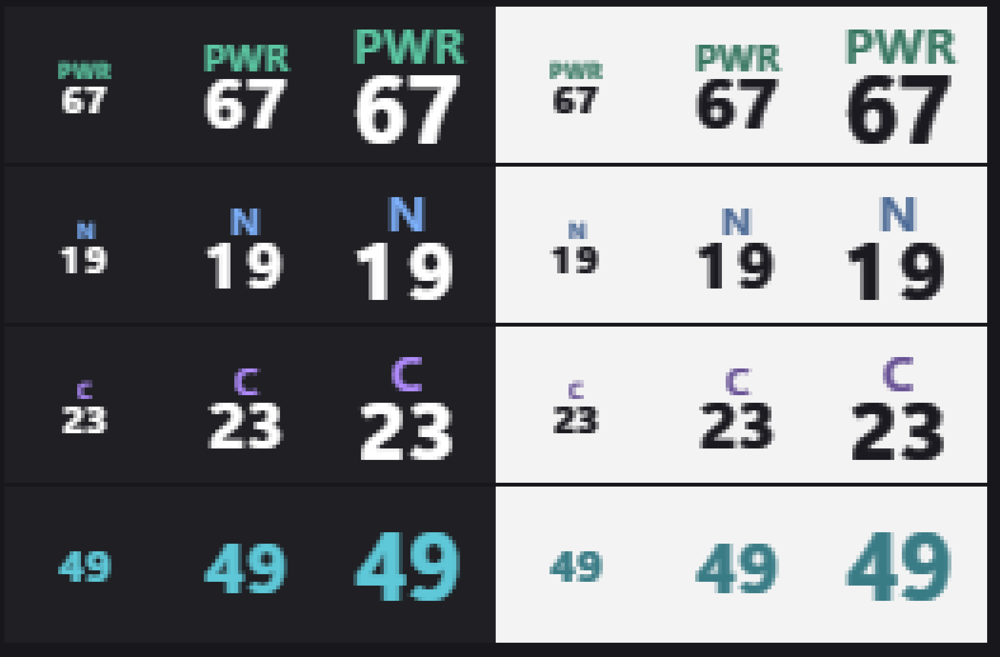

# TrayMetrics

> 一个常驻 Windows 托盘的实时系统监控小工具：托盘图标一次只显示一种指标（网速 / 整机功率 / CPU / 内存 / 磁盘 / 温度 / GPU），右键切换类型，左键弹出详情面板。纯本地运行，不联网、不上传任何数据。



## 特性

- **托盘即仪表盘**：任务栏通知区一个小图标，实时刷新当前指标的数值（用系统真实字体渲染，不是像素方块）。
- **七类指标，一键切换**：网速、整机功率、CPU、内存、磁盘、温度、GPU，右键菜单任意切换；也可在面板里点「全部指标」同时查看。
- **整机功率实测优先**：优先用 Intel/AMD 的 RAPL（`Energy Meter` / `Package` 计数器，Windows 自带 `typeperf` 读取，无需管理员、无需第三方软件）、电池供电时的 Windows Power Meter（整机 DC 实测）、NVIDIA `nvidia-smi`；都没有时再用「CPU 封装 + GPU + 平台基线」估算，并在一次电池供电后自动校准基线。
- **详情面板**：左键图标弹出，含大数字、迷你走势图、各项明细、数据来源说明；面板高度随内容自适应，关掉即释放渲染进程（空闲常驻内存约 130MB）。
- **零原生依赖**：只用 Node + Electron，所有采集走 `os` / `netstat` / `WMI`（PowerShell 短命调用）/ `typeperf` / `nvidia-smi` / 可选的 LibreHardwareMonitor（`:8085`）。无需 .NET SDK，无需装驱动。
- **开机自启 & 任务栏深浅色自适应**：支持「自动 / 浅色 / 深色」三档，跟随或固定任务栏配色。
- **单实例**：重复启动会自动聚焦已运行的实例。

## 支持的指标

| 类型 | 缩写 | 单位 | 数据来源 |
| --- | --- | --- | --- |
| 网速 | NET | MB/s | `netstat -e` 累计字节按真实时间戳差分（2s） |
| 整机功率 | PWR | W | RAPL / Power Meter / nvidia-smi（实测优先，否则估算） |
| CPU | CPU | % | `os.cpus()` 两次采样差分 |
| 内存 | MEM | % | `os.totalmem` / `os.freemem`（2s） |
| 磁盘 | DSK | % | `fs.statfsSync` / WMI（占用 2s，读写速率 10s） |
| 温度 | TMP | °C | LibreHardwareMonitor `:8085` / `nvidia-smi` |
| GPU | GPU | % | LibreHardwareMonitor GPU / `nvidia-smi` |

> **关于温度与 GPU 明细**：CPU/硬盘/风扇温度、GPU 核心温度需要 LibreHardwareMonitor（LHM）开启 Web Server（端口 8085）。LHM 是可选增强，不装也能用，只是少了温度来源。网速、功率、CPU、内存、磁盘均无需任何第三方软件。

## 安装与运行

```bash
# 需要 Node.js（已验证 Electron 45.2.3）
npm install
npm start
```

也可以直接双击项目里的 `start.bat`（它会自动清除可能干扰的环境变量后启动）。

启动后右下角托盘出现图标：

- **右键** → 切换指标类型 / 打开设置（重新检测、数据源说明、墙插功率配置、任务栏深浅、开机自启）/ 退出
- **左键** → 弹出/收起详情面板

## 设置

| 设置 | 说明 |
| --- | --- |
| 重新检测数据源 | 重新探测 RAPL / LHM / nvidia-smi 可用性 |
| 墙插功率配置 | 填入智能插座 HTTP 接口地址，可接入 AC 侧真实功率（含电源适配器损耗） |
| 任务栏深浅 | 自动 / 浅色 / 深色，控制图标在深浅任务栏上的对比度 |
| 开机自启 | 通过 `App.setLoginItemSettings` 注册开机启动 |

## 数据准确性说明

- **整机功率是本工具的重点**：普通 PC 没有墙插功率传感器，因此优先用 RAPL（CPU 封装实测，误差很小）加 GPU 实测，再加一个平台基线（屏幕/内存/主板/风扇，默认约 12W，电池供电一次即可自动校准）。有智能插座或 PMBus 电源时填 `wallPowerUrl` 可拿到最准的 AC 实测。
- **网速** 由 `netstat -e` 累计字节按真实时间戳差分得出，开启 VPN / 虚拟网卡时可能偏高。
- 所有数据只在本地进程内计算，不上任何网络。

## 技术说明

- **真实字体托盘图标**：图标每秒在主进程重绘，为了省内存不常驻渲染进程。启动时用一个隐藏窗口把所需字符（数字、`.`、`-`、字母）按系统字体（Segoe UI）栅格化成字形图集，取回后立即销毁窗口；之后每帧纯 JS 贴图合成，获得清晰抗锯齿文字而非像素方块。
- **DPI 处理**：托盘位图物理尺寸 = 16 逻辑像素 × 显示缩放（150% 下为 24px），声明为 1× 表示避免被系统二次放大发虚。
- 采集分层降级：主路径纯 Node；慢变量用短命 PowerShell 调用（约 10s 一次、8s 超时）；功率用 `typeperf` 读 RAPL；GPU 用 `nvidia-smi`；LHM 可选。

## 开发脚本

```bash
npm start        # 启动应用
npm run probe    # 检测各数据源可用性
npm run selftest # 无界面自检（图标/面板/采集）
npm run icons    # 生成图标放大预览（icon-preview.png）
npm run ink      # 把图标位图打成字符画，检查是否贴边
npm run shot     # 渲染面板并截图核对布局
```

## 目录结构

```
tray-monitor-app/
├── src/
│   ├── main.js        # 主进程：托盘、菜单、面板窗口、配置
│   ├── metrics.js     # 采集层（分层降级：Node / PowerShell / typeperf / nvidia-smi / LHM）
│   ├── glyphs.js      # 真实字体字形图集（一次性栅格化后销毁窗口）
│   ├── icon.js        # 托盘图标合成（纯 JS 贴图）
│   ├── panel.html/.js # 详情面板 UI
│   ├── collector.ps1  # WMI 短命采集脚本
│   └── *.js           # 自检 / 截图 / 预览等开发工具
├── start.bat          # Windows 启动脚本
└── package.json
```

## 许可

MIT（如使用 LibreHardwareMonitor 获取温度，请遵守其许可）。
