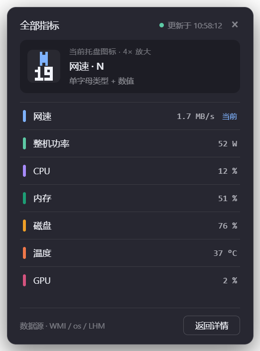

# TrayMetrics

> 一个常驻 Windows 托盘的实时系统监控小工具：托盘图标一次只显示一种指标（网速 / 整机功率 / CPU / 内存 / 磁盘 / 温度 / GPU），右键切换类型，左键弹出详情面板。纯本地运行，不联网、不上传任何数据。


| 托盘图标（放大预览） | 左键弹出的详情面板 |
| ---------- | --------- |
| 托盘图标预览     | 详情面板      |



## 特性

- **托盘即仪表盘**：任务栏通知区一个小图标，实时刷新当前指标的数值（用系统真实字体渲染，不是像素方块）。
- **七类指标，一键切换**：网速、整机功率、CPU、内存、磁盘、温度、GPU，右键菜单任意切换；也可在面板里点「全部指标」同时查看。
- **整机功率实测优先**：优先用 Intel/AMD 的 RAPL（`Energy Meter` / `Package` 计数器，Windows 自带 `typeperf` 读取，无需管理员、无需第三方软件）、电池供电时的 Windows Power Meter（整机 DC 实测）、NVIDIA `nvidia-smi`；都没有时再用「CPU 封装 + GPU + 平台基线」估算，并在一次电池供电后自动校准基线。
- **详情面板**：左键图标弹出，含大数字、迷你走势图、各项明细、数据来源说明；面板高度随内容自适应，关掉即释放渲染进程（空闲常驻内存约 130MB）。
- **零原生依赖**：只用 Node + Electron，所有采集走 `os` / `netstat` / `WMI`（PowerShell 短命调用）/ `typeperf` / `nvidia-smi` / 可选的 LibreHardwareMonitor（`:8085`）。无需 .NET SDK，无需装驱动。
- **开机自启 & 任务栏深浅色自适应**：支持「自动 / 浅色 / 深色」三档，跟随或固定任务栏配色。
- **单实例**：重复启动会自动聚焦已运行的实例，不会开第二个托盘图标。

## 支持的指标

| 类型   | 缩写  | 单位   | 数据来源                                        |
| ---- | --- | ---- | ------------------------------------------- |
| 网速   | NET | MB/s | `netstat -e` 累计字节按真实时间戳差分（2s）               |
| 整机功率 | PWR | W    | RAPL / Power Meter / nvidia-smi（实测优先，否则估算）  |
| CPU  | CPU | %    | `os.cpus()` 两次采样差分                          |
| 内存   | MEM | %    | `os.totalmem` / `os.freemem`（2s）            |
| 磁盘   | DSK | %    | `fs.statfsSync` / WMI（占用 2s，读写速率 10s）       |
| 温度   | TMP | °C   | LibreHardwareMonitor `:8085` / `nvidia-smi` |
| GPU  | GPU | %    | LibreHardwareMonitor GPU / `nvidia-smi`     |

> **关于温度与 GPU 明细**：CPU/硬盘/风扇温度、GPU 核心温度需要 LibreHardwareMonitor（LHM）开启 Web Server（端口 8085）。LHM 是可选增强，不装也能用，只是少了温度来源。网速、功率、CPU、内存、磁盘均无需任何第三方软件。

## 快速开始

### 方式一：直接运行打包好的 exe（推荐）

在本仓库的 **Releases** 页面下载（Windows x64）：

| 文件                              | 说明                             |
| ------------------------------- | ------------------------------ |
| `TrayMetrics-<版本>-Portable.exe` | 免安装单文件版，双击即用，不写注册表，约 100MB     |
| `TrayMetrics-<版本>-Setup.exe`    | NSIS 安装包，带开始菜单 / 桌面快捷方式 / 卸载程序 |

程序未做商业代码签名，首次运行 Windows SmartScreen 可能提示「未知发布者」，点「更多信息 → 仍要运行」即可（也可自行构建并用自己的证书签名）。

### 方式二：自己从源码打包

```bash
git clone <本仓库地址>
cd tray-monitor-app
npm ci
npm run dist          # 同时产出 NSIS 安装包 + 便携版，输出在 dist/
```

也可单独构建：`npm run dist:nsis` / `npm run dist:portable`。打包配置见 [`electron-builder.js`](./electron-builder.js)。

### 方式三：源码运行（开发调试）

```bash
npm ci
npm start
```

也可以双击 `start.bat`（它会先清掉可能干扰启动的环境变量）。需要 Node.js 18+ 与 Windows 10/11 x64。

启动后右下角托盘出现图标（常被系统收进 `^` 隐藏区，把图标拖出来即可）：

- **右键** → 切换指标类型 / 打开设置（重新检测、数据源说明、墙插功率配置、任务栏深浅、开机自启）/ 退出
- **左键** → 弹出详情面板；面板稳定显示后再点一次托盘可收起，也可点面板右上角 `×` 或按 `Esc` 关闭

## 设置

| 设置      | 说明                                      |
| ------- | --------------------------------------- |
| 重新检测数据源 | 重新探测 RAPL / LHM / nvidia-smi 可用性        |
| 墙插功率配置  | 填入智能插座 HTTP 接口地址，可接入 AC 侧真实功率（含电源适配器损耗） |
| 任务栏深浅   | 自动 / 浅色 / 深色，控制图标在深浅任务栏上的对比度            |
| 开机自启    | 通过 `app.setLoginItemSettings` 注册开机启动    |

配置保存在 `%APPDATA%\TrayMetrics\config.json`，可直接编辑。

## 数据准确性说明

- **整机功率是本工具的重点**：普通 PC 没有墙插功率传感器，因此优先用 RAPL（CPU 封装实测，误差很小）加 GPU 实测，再加一个平台基线（屏幕/内存/主板/风扇，默认约 12W，电池供电一次即可自动校准）。有智能插座或 PMBus 电源时填 `wallPowerUrl` 可拿到最准的 AC 实测。
- **网速** 由 `netstat -e` 累计字节按真实时间戳差分得出，开启 VPN / 虚拟网卡时可能偏高。
- 所有数据只在本地进程内计算，不上任何网络。

## 技术实现

- **框架**：Electron 45.2.3（主进程管托盘/菜单/窗口，渲染进程只负责详情面板）。
- **真实字体托盘图标**：图标每秒在主进程重绘，为了省内存不常驻渲染进程。启动时用一个隐藏窗口把所需字符（数字、`.`、`-`、字母）按系统字体（Segoe UI）栅格化成字形图集，取回后立即销毁窗口；之后每帧纯 JS 贴图合成，获得清晰抗锯齿文字而非像素方块。
- **采集分层降级**：主路径纯 Node（`os` / `fs`）；慢变量用短命 PowerShell 调用（约 10s 一次、8s 超时）；功率用 `typeperf` 读 RAPL；GPU/温度用 `nvidia-smi`；LHM 为可选 HTTP 数据源。
- **DPI 处理**：托盘位图物理尺寸 = 16 逻辑像素 × 显示缩放（150% 下为 24px），声明为 1× 表示避免被系统二次放大发虚。
- **打包**：`electron-builder` 一次构建产出 NSIS + portable；`electronDist` 复用本地已安装的 Electron 运行时避免联网重下；无证书时用 no-op 签名回调跳过 Authenticode。GitHub Actions 工作流会在打 `v*` 标签时自动构建并把两个 exe 附加到 Release。

## 打包与发布

```bash
npm run dist          # dist/TrayMetrics-1.0.0-Setup.exe + TrayMetrics-1.0.0-Portable.exe
npm run dist:nsis     # 只出安装包
npm run dist:portable # 只出便携版
```

CI 见 [`.github/workflows/build.yml`](./.github/workflows/build.yml)：`git tag v1.0.0 && git push origin v1.0.0` 即触发 Windows 构建并自动上传 Release 附件。

**项目介绍页**：[`docs/index.html`](./docs/index.html) 是一个自包含的单页介绍站，在 Settings → Pages 选 `main /docs` 即可发布（本项目地址 <https://ipgtzuo.github.io/tray-metrics/>）；仓库 About 描述、Topics、首个 Release 文案与上架自检清单见 [`docs/GITHUB_SETUP.md`](./docs/GITHUB_SETUP.md)。仓库地址 <https://github.com/ipgtzuo/tray-metrics>，如需迁移到其它仓库可用 [`push-to-github.ps1`](./push-to-github.ps1) 自动改写链接并重新推送。

> **从终端/脚本启动 exe 时静默退出？** 若当前 shell 注入了 `ELECTRON_RUN_AS_NODE=1`（某些 IDE / Agent 运行时会注入），Electron 会被当成纯 Node 运行，表现为「退出码 0、界面不出现、应用代码完全没加载」。这与打包无关，去掉该环境变量再启动即可（`start.bat` 已处理），双击 exe 不受影响。

## 开发脚本

```bash
npm start          # 启动应用
npm run probe      # 检测各数据源可用性
npm run selftest   # 无界面自检（图标/面板/采集）
npm run icons      # 生成图标放大预览（icon-preview.png）
npm run ink        # 把图标位图打成字符画，检查是否贴边
npm run shot       # 渲染面板并截图核对布局
```

## 目录结构

```
tray-monitor-app/
├── .github/workflows/build.yml  # Windows 打包 + Release 上传
├── assets/
│   ├── icon.ico                # 应用图标（多分辨率 ICO）
│   └── make_icon.py            # 图标生成脚本（Pillow）
├── docs/                       # README 用截图
├── src/
│   ├── main.js                 # 主进程：托盘、菜单、面板窗口、配置
│   ├── metrics.js              # 采集层（Node / PowerShell / typeperf / nvidia-smi / LHM）
│   ├── glyphs.js               # 真实字体字形图集（一次性栅格化后销毁窗口）
│   ├── icon.js                 # 托盘图标合成（纯 JS 贴图）
│   ├── panel.html / panel.js   # 详情面板 UI
│   ├── preload.js              # 面板与主进程之间的 IPC 桥
│   ├── collector.ps1           # WMI 短命采集脚本
│   └── *.js                    # 自检 / 截图 / 预览等开发工具
├── electron-builder.js         # 打包配置
├── start.bat                   # Windows 启动脚本（清理干扰环境变量）
└── package.json
```

## 常见问题

| 现象                    | 处理                                                                                    |
| --------------------- | ------------------------------------------------------------------------------------- |
| 托盘看不到图标               | 点任务栏 `^` 展开隐藏图标区，把 TrayMetrics 拖到可见区；首次启动会有气泡提示。                                      |
| 左键点图标后面板一闪而过 / 一片黑 | 旧版用「窗口失焦就自动收起」，点托盘时 Windows 会先把焦点交给任务栏，面板刚弹出就被关掉；且透明窗口在部分 GPU / 远程会话下会渲染成纯黑。现已改为不透明窗口 + 显式关闭（再点托盘 / `×` / `Esc`），不再依赖失焦判断。 |
| 每点一次托盘，面板就长高一点 | 旧版定位时读取窗口 `getSize()` 再算 `y = 托盘y - h - 8`；在 150% 缩放下 Windows 回报的尺寸每次多 1～2px，底边固定、顶边上移，形成正反馈。现改用固定设计尺寸计算位置，且只在新建窗口 / 内容高度变化 / 显示器变化时定位一次。 |
| 温度 / GPU 显示 `--`      | 这两项依赖 LibreHardwareMonitor（开启 Web Server :8085）或 NVIDIA 驱动自带的 `nvidia-smi`，不装不影响其它指标。 |
| 杀软报毒 / SmartScreen 拦截 | exe 未做商业签名，源码与构建脚本全部公开，可自行 `npm run dist` 复现构建。                                       |
| 从 CI/脚本启动后立刻退出        | 检查并清除 `ELECTRON_RUN_AS_NODE` 环境变量，见上文「打包与发布」。                                         |
| 想彻底卸载                 | 安装包版走系统「应用和功能」；便携版直接删除 exe，再手动删 `%APPDATA%\TrayMetrics`。                              |

## 贡献

欢迎提 Issue / PR。改采集逻辑时建议先跑 `npm run probe` 与 `npm run selftest`，并说明你的硬件环境（CPU / GPU / 是否有电池 / 是否装 LHM），因为功率与温度的数据源高度依赖机器。

## 许可

[MIT](./LICENSE)。若启用 LibreHardwareMonitor 获取温度，请同时遵守其许可；`nvidia-smi` 属于 NVIDIA 驱动组件。
